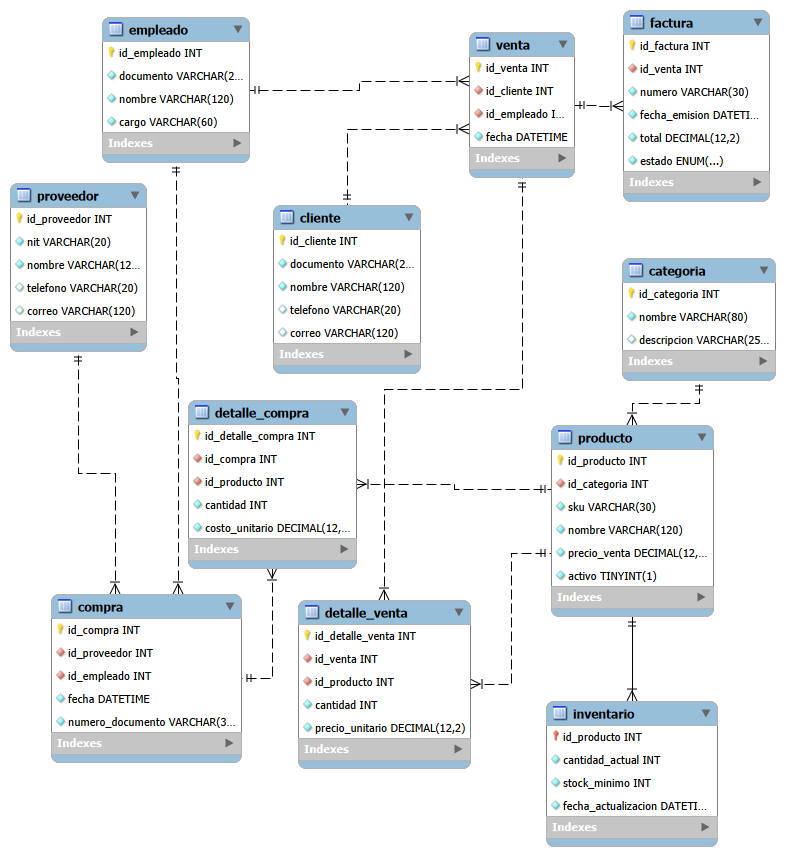

# 🛠️ FerreHogar — Diseño e Implementación de Base de Datos Relacional (MySQL)

"FerreHogar" es un modelo relacional de base de datos diseñado para optimizar los procesos operativos y comerciales de una ferretería. La solución contempla el control integral de inventarios, catálogo de productos, gestión de clientes y proveedores, registro de empleados y trazabilidad de transacciones comerciales (compras y ventas con sus respectivos detalles).

*******************************************************************************************************************

## 📐 Modelo Entidad-Relación (Diagrama ER)

A continuación se presenta la arquitectura lógica y relacional de la base de datos, normalizada bajo la Tercera Forma Normal (3FN) para garantizar la integridad referencial y eliminar la redundancia de datos:

*******************************************************************************************************************

## 🗄️ Estructura de Entidades y Relaciones

El modelo relacional está compuesto por las siguientes entidades interconectadas:

-`Clientes` & `Proveedores`: Registro estructurado de terceros, datos de contacto, identificación fiscal y ubicación.
-`Empleados` & `Cargos`: Estructura organizacional para la asignación de ventas y control de roles.
- `Productos` & `Categorias`: Gestión de inventario con control de stock, precios unitarios y clasificación comercial.
- `Ventas` & `Detalle_Ventas`: Registro de transacciones comerciales, vinculando cliente, vendedor, productos solicitados, cantidades y montos totales.
- `Compras` & `Detalle_Compras`: Control de reabastecimiento de mercancía ante proveedores.

*******************************************************************************************************************

## 🛠️ Tecnologías y Estándares
- SGBD: MySQL 8.0 / MariaDB
- Modelado: MySQL Workbench (Normalización 3FN) 
- Lenguaje: SQL (Sentencias DDL para definición de tablas y llaves foráneas, DML para inserción de datos de prueba)

*******************************************************************************************************************

## 📁 Estructura del Repositorio

  text
  FerreHogar-MySQL-Database/
  ├── script\_ferrehogar.sql               # Script SQL con DDL (creación de tablas) y DML
  (inserción de datos)
  ├── diagrama\_er\_ferrehogar.png         # Diagrama Entidad-Relación en alta resolución
  └── README.md # Documentación técnica del proyecto

*******************************************************************************************************************

⚙️ Cómo Ejecutar el Script SQL

1. Clonar el repositorio:
   git clone https://github.com/Theluxe1992/FerreHogar-MySQL-Database.git

2. Importar en MySQL Workbench:
     * Abre **MySQL Workbench** y conéctate a tu servidor local.
     * Ve al menú File > Open SQL Script... y selecciona tu archivo `.sql`.
     * Ejecuta el script completo presionando el ícono del rayo ⚡.

3. O desde la consola de MySQL:
    mysql -u tu_usuario -p < script_ferrehogar.sql

*******************************************************************************************************************

## 👤 Autor

Juan Pablo Alarcón Naranjo Estudiante de Tecnología en Desarrollo de Software — UNAD

* 📧 Email: junecropa@outlook.com
* 🐙 GitHub: [@Theluxe1992](https://www.google.com/url?sa=E&amp;q=https%3A%2F%2Fgithub.com%2FTheluxe1992)
